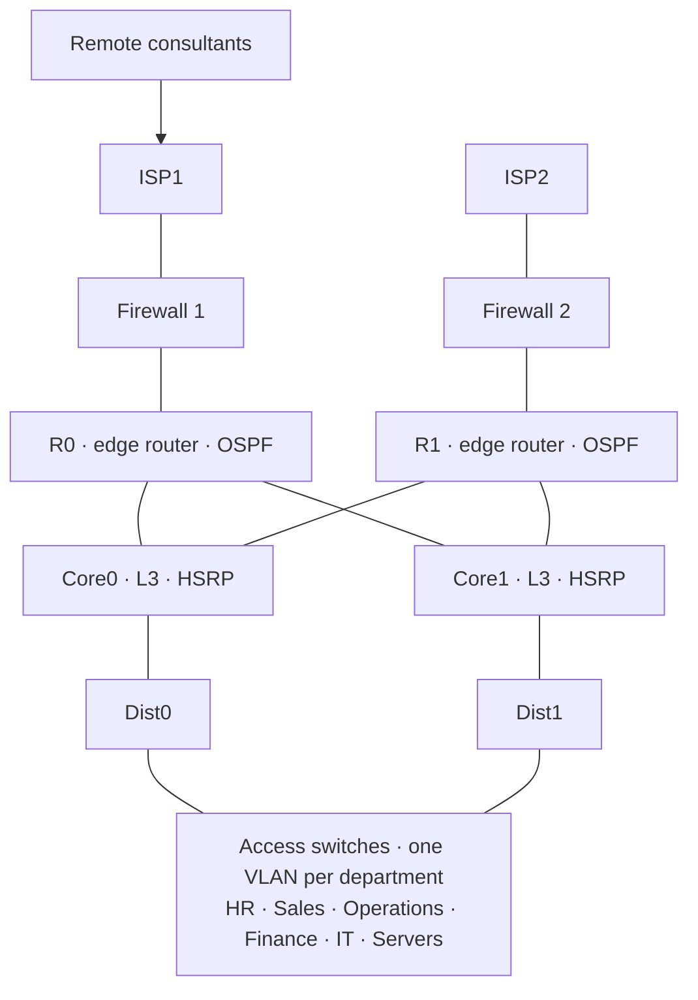

<!-- ========== HEADER ========== -->

 

---

## 👋 About me

I'm a student of the **CFGS in Network Systems Administration (ASIR) – Cybersecurity**. I build and document projects around networking, systems and security, from enterprise network designs and secure web apps to scripting exercises.

 

---

## 🛠️ Stack

**Networking**

`OSPF` · `HSRP` · `VLAN / VTP` · `STP` · `NAT / PAT` · `ACLs` · `DHCP` · `DNS` · `SSH`

**Security**

`Firewalls` · `Panorama` · `Site-to-site VPN` · `Remote-access VPN`

**Systems & virtualization**

**Monitoring & tools**

**Scripting, web & data**

---

## 📂 Featured projects

<b>🌐 AlwaysOnTech — network topology</b>

 

---

## 🏅 Certifications

| Certification | Issuer | Status |
|---|---|---|
| **CCNA: Introduction to Networks** (70 h) | Cisco Networking Academy | 🟡 In progress |

## 🎓 Education

- **CFGS in Network Systems Administration (ASIR) – Cybersecurity** · IFP, Barcelona · 2025 – Present
- **B.Sc. in Sports Management** · Queens University of Charlotte · 2019 – 2022

---

## 📈 GitHub activity

 

---

### 📫 Let's talk

Interested in networking, security or my projects? Reach out on LinkedIn.

